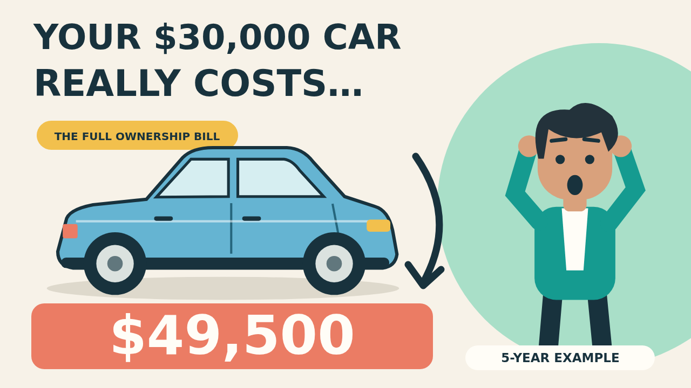
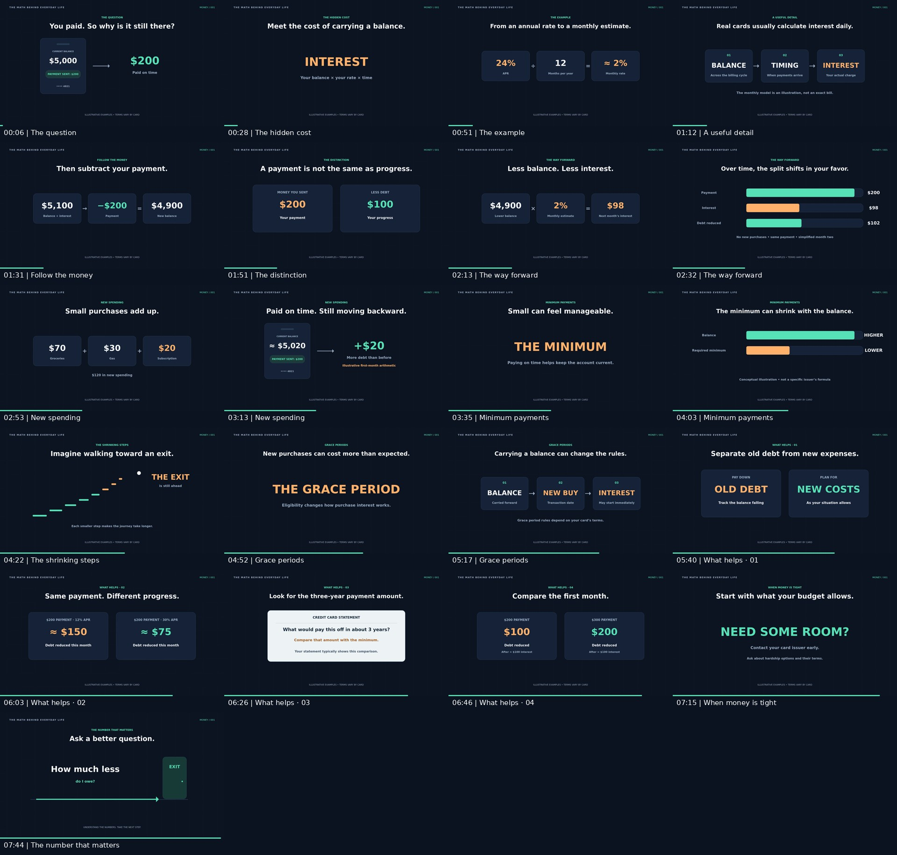

# GPT Motion Canvas

## Phòng xem online

**[Mở Motion Room](https://tai23082004l02-svg.github.io/GPT-motion-canvas/)** — xem hoạt hình trực tiếp hoặc **xuất MP4 để đăng YouTube**. Có phát/dừng, tua cảnh, âm thanh đồng bộ, phụ đề, tốc độ phát và lưu tiến độ trên trình duyệt.


**Cách xuất video:** chọn tập → bấm **Xuất MP4** dưới video → chọn 1080p hoặc 720p → **Bắt đầu xuất**. Giữ trang mở đến khi file tải xuống. File gồm hình và âm thanh ở 30 fps, tốc độ gốc; có thể xuất thử 10 giây, gắn phụ đề vào hình hoặc tải SRT/thumbnail riêng. Nên dùng Chrome/Edge mới trên máy tính.

- [Mã nguồn công cụ](viewer/): `cd viewer`, `npm ci`, `npm run dev` để chạy local.
- [Tự động triển khai](.github/workflows/motion-room-pages.yml): cập nhật `viewer/` trên nhánh `main` sẽ chạy kiểm tra và đưa bản mới lên GitHub Pages.

Alex trong phòng xem đã được giữ ổn định đầu/cổ theo góp ý. Các file MP4 cũ vẫn nằm trong mục tải bên dưới; trình xem không dùng chúng.

## Tập 008 — mới nhất · SCOPIVO

**How Rich Is Elon Musk, Really? The iPhone Test** — từ gần 770 triệu iPhone tương đương đến tài sản ròng, quyền sở hữu và khả năng chuyển thành tiền.

**17 phút 40 giây · 53 đoạn kể / 291 lượt cắt hình · Kokoro Michael · Times New Roman/serif**

- **[Xem tập 008 online](https://tai23082004l02-svg.github.io/GPT-motion-canvas/?episode=musk)**
- [Kịch bản, nguồn, phụ đề, thumbnail và thông tin đăng YouTube](episodes/musk-wealth/)


## Tập 007 · SCOPIVO

**What If Donald Trump Had Grown Up in China?** — giả tưởng về ba ngã rẽ: doanh nhân xây dựng, người của công chúng và người tìm kiếm ảnh hưởng. Phân biệt bối cảnh có nguồn với những diễn biến hư cấu.

**9 phút 10 giây · 32 đoạn kể / 154 lượt cắt hình · Kokoro Michael · Times New Roman/serif**

- **[Xem tập 007 online](https://tai23082004l02-svg.github.io/GPT-motion-canvas/?episode=china)**
- [Kịch bản, nguồn, phụ đề và thông tin đăng YouTube](episodes/trump-china/)


## Tập 006 · SCOPIVO

**How Did People Survive Winter Before Electricity?** — theo chân Joan, Will và Kit, một gia đình hư cấu ở miền nam nước Anh khoảng năm 1400. Người que có biểu cảm, nền minh họa, đạo cụ và hành động theo câu chuyện.

**9 phút 01 giây · 32 cảnh · Kokoro Michael · nhạc và hiệu ứng riêng · Times New Roman/serif · không có bộ đếm cảnh trong hình**

- **[Xem tập 006 online](https://tai23082004l02-svg.github.io/GPT-motion-canvas/?episode=winter)**
- [Kịch bản, nguồn nghiên cứu và bộ bàn giao](episodes/winter-before-electricity/)
- [Thumbnail](episodes/winter-before-electricity/deliverables/thumbnail.png)
- [Phụ đề tiếng Anh](episodes/winter-before-electricity/deliverables/captions.en.srt)


## Tập 005

**Why Scam Ads Keep Finding You — Meta’s New Lawsuit Explained** — vụ kiện Rhode Island, phản hồi của Meta và hành trình từ quảng cáo hấp dẫn đến nhóm đầu tư giả. Phân biệt rõ cáo buộc, số liệu và minh họa.

**7 phút 10 giây · 24 cảnh · Kokoro Michael · chữ Times New Roman/serif · bàn tay tròn · không có bộ đếm cảnh trong hình**

- **[Xem tập 005 online](https://tai23082004l02-svg.github.io/GPT-motion-canvas/?episode=meta)**
- [Kịch bản, nguồn và bộ bàn giao](episodes/meta-scam-ads/)
- [Thumbnail](episodes/meta-scam-ads/deliverables/thumbnail.png)


## Tập 004

**Why Your Free Trial Is So Hard to Cancel** — theo Alex từ nút dùng thử đến mê cung hủy đăng ký. Thêm hành động, biểu cảm, cỡ cảnh và đạo cụ; đầu/cổ giữ ổn định.

**6 phút 31 giây · 24 cảnh · Kokoro Michael · nhạc và Foley riêng**

- **[Xem tập 004 online](https://tai23082004l02-svg.github.io/GPT-motion-canvas/?episode=trial)**
- [Kịch bản, nguồn và bộ bàn giao](episodes/free-trial/)
- [Thumbnail](episodes/free-trial/deliverables/thumbnail.png)


## Tập 003

**Why You Keep Scrolling When You’re Not Even Having Fun** — câu chuyện về Alex, thói quen kiểm tra điện thoại, feed vô tận và cách tạo điểm dừng.

**6 phút 56 giây · 30 cảnh · giọng Kokoro Michael · nhạc và hiệu ứng riêng**

- **[Xem tập 003 online](https://tai23082004l02-svg.github.io/GPT-motion-canvas/?episode=scroll)**
- [Kịch bản, nguồn nghiên cứu và bộ bàn giao](episodes/scrolling/)
- [Phụ đề tiếng Anh](episodes/scrolling/deliverables/captions.en.srt)
- [Thumbnail](episodes/scrolling/deliverables/thumbnail.png)


## Tập 002

**Your $30,000 Car Costs More Than You Think** — hoạt hình 2D với Alex, thợ máy, xe và bối cảnh chuyển động. Giọng **Kokoro Michael**, nhạc nền và hiệu ứng âm thanh riêng.

**1080p · 30 fps · 8 phút 31 giây · 36 cảnh**

- [Tải video MP4](downloads/car-ownership-1080p.mp4)
- [Tải bộ đầy đủ ZIP](downloads/car-ownership-production-kit.zip)
- [Mã nguồn và hướng dẫn chạy](episodes/car-ownership/)
- [Thumbnail](episodes/car-ownership/deliverables/thumbnail.png)
- [Phụ đề tiếng Anh](episodes/car-ownership/deliverables/captions.en.srt)



## Tập 001 — Credit Card Explainer

Video đầu tiên: **Why Your Credit Card Balance Barely Moves** — animation tiếng Anh dành cho YouTube, dựng bằng Motion Canvas.

**1920 × 1080 · 30 fps · 7 phút 52 giây · 41 cảnh**

## Tải video và bộ bàn giao

- [Video MP4 1080p](https://github.com/tai23082004l02-svg/GPT-motion-canvas/raw/refs/heads/main/downloads/credit-card-explainer-1080p.mp4)
- [Bộ đầy đủ ZIP: video, mã nguồn, phụ đề, 9 đoạn audio và storyboard](https://github.com/tai23082004l02-svg/GPT-motion-canvas/raw/refs/heads/main/downloads/credit-card-production-kit.zip)
- [Thư mục downloads](downloads/): mở file rồi bấm **Download raw file** nếu trình duyệt chưa tự tải.
- Mã nguồn có sẵn ngay trong repo; có thể tải bằng **Code → Download ZIP**.



## Chạy project

Yêu cầu Node.js 20+.

```bash
npm ci
npm start
```

Mở địa chỉ Vite hiển thị để xem và chỉnh sửa trong Motion Canvas editor. Audio gốc đã có trong `public/narration.wav`.

- `src/scenes/main.tsx`: hình và animation.
- `src/cues.json`: mốc thời gian và nội dung 41 cảnh.
- `deliverables/`: phụ đề SRT, bảng thời gian, transcript, mốc chương YouTube và storyboard.
- [Hướng dẫn chi tiết](README-vi.md): cách render và các giả định tài chính.

Video giữ nguyên nội dung và tốc độ audio gốc; âm lượng lời đọc được cân bằng khi xuất MP4. Phụ đề trong MP4 có thể bật/tắt. Các phép tính theo tháng là minh họa; lãi thực tế và điều khoản phụ thuộc từng thẻ.
