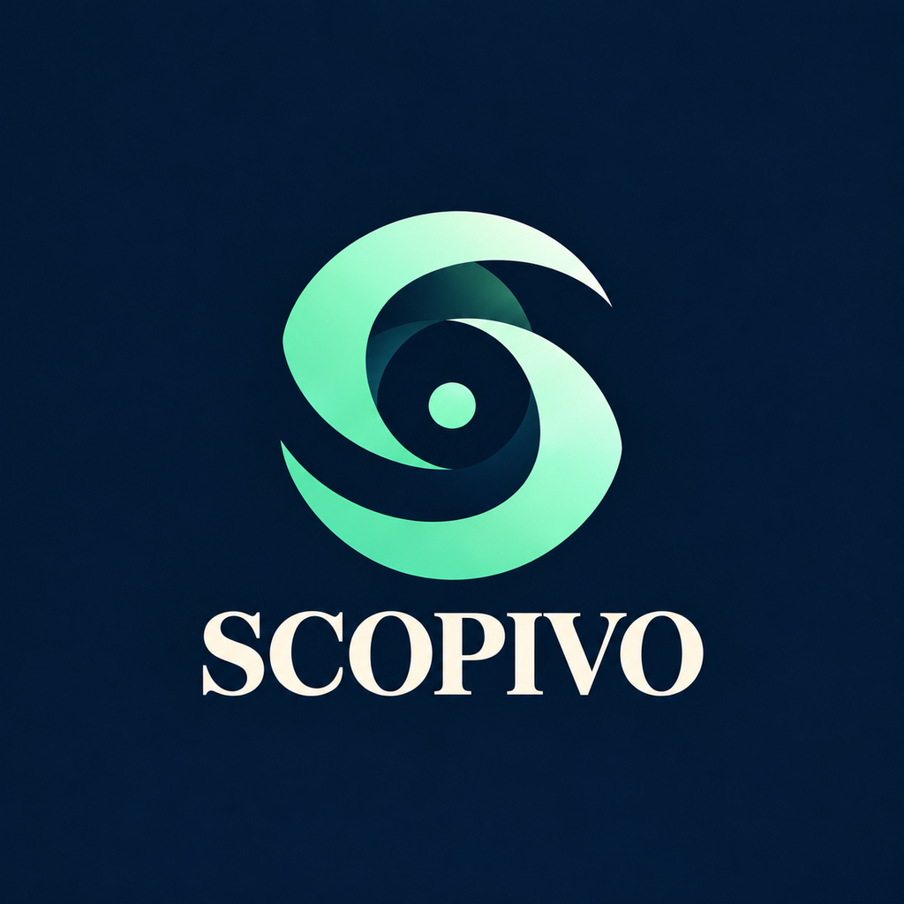
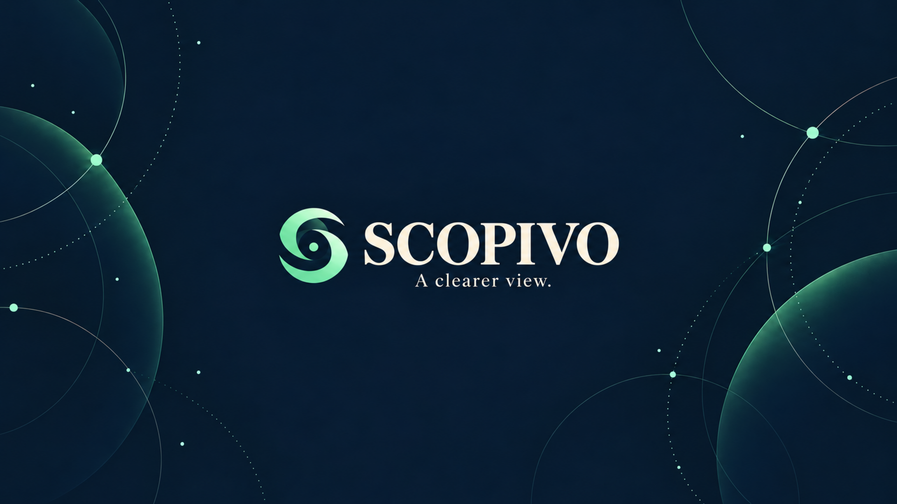

# SCOPIVO channel artwork

Ready-to-upload YouTube channel artwork with a navy background, mint emblem and ivory serif lettering.

- [Download avatar — 1024 × 1024 PNG](https://raw.githubusercontent.com/tai23082004l02-svg/GPT-motion-canvas/main/branding/scopivo/scopivo-avatar-1024.png)
- [Download banner — 2560 × 1440 PNG](https://raw.githubusercontent.com/tai23082004l02-svg/GPT-motion-canvas/main/branding/scopivo/scopivo-banner-2560x1440.png)

In YouTube Studio, open **Customization → Profile**, replace the profile picture and banner, check the crop preview, then select **Publish**.

The banner keeps the logo, channel name and tagline centered for mobile cropping. The avatar allows space for a circular crop. Artwork was generated with OpenAI image generation and resized for delivery.

## Avatar

## Banner

